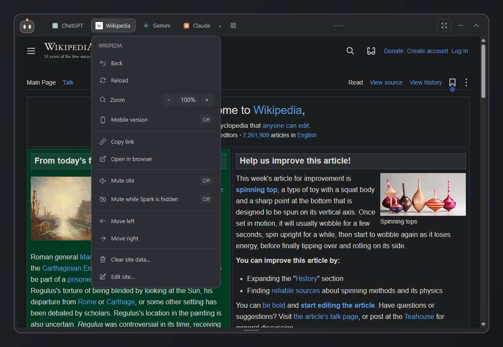
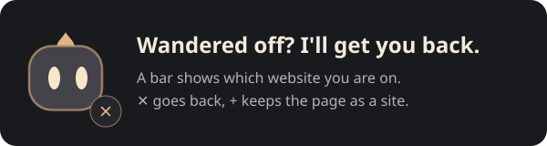
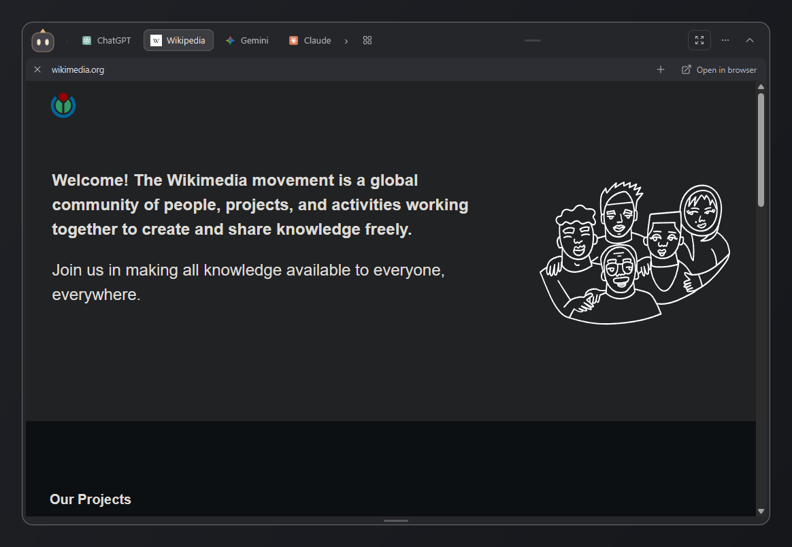
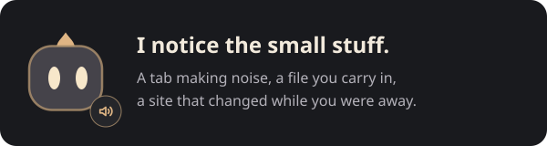
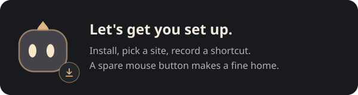
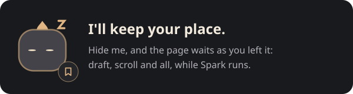
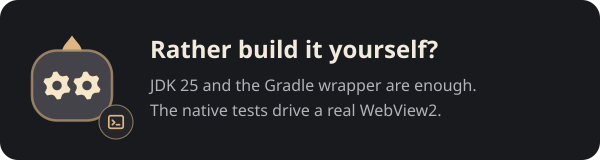
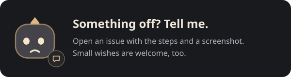

<p align="center">
  
</p>

<p align="center">
  <strong><a href="https://github.com/OldValencia/spark/releases">Download for Windows</a></strong>
  &nbsp;·&nbsp; <a href="#watch-spark">Watch Spark</a>
  &nbsp;·&nbsp; <a href="#a-quick-tour">Take a look around</a>
  &nbsp;·&nbsp; <a href="#start-here">Get started</a>
  &nbsp;·&nbsp; <a href="docs/troubleshooting.md">Troubleshooting</a>
  &nbsp;·&nbsp; <a href="#build-it">Build it</a>
</p>

Spark started with a shortcut on a spare mouse button: ask something, hide the window, come back to the same page. That's still the idea.

Keep **ChatGPT, Claude, Gemini, Mistral, Perplexity, Copilot**, or your own regular sites in a small desktop window. A question comes up, you open Spark, use the website, and put it away again. Your draft and scroll position stay with the page while Spark is running. On Windows you can bring a few Chrome extensions along, too.

## Watch Spark

<p align="center">
  
</p>

Open it, switch sites, find one by name, open a tab's menu, wander off to another website and come back, try a smaller window, open an extension, glance at the settings, and put it away.

<p align="center">
  <a href="docs/media/spark-tour.mp4"></a>
  <br><sub>Recorded in Spark 0.3.6 with a separate, signed-out profile. <a href="docs/media/spark-tour.mp4">MP4</a> · <a href="docs/media/spark-tour-poster.png">Still image</a></sub>
</p>

## A quick tour

<p align="center">
  <a href="docs/readme/tour.svg"></a>
</p>

Meet **Sparky**, Spark's mascot. Sparky follows your pointer, peeks at the site list, and briefly gets gear eyes when you open settings. It turns its gears while a page loads, looks sad when a page can't load, and dozes off when Spark sits untouched for a while. Click Sparky for a hello. **General → Reduce motion** keeps Sparky still; **Show Sparky** lets it sit this one out.

<sub>The tour and Sparky's cards are illustrations; the screenshots show the Windows app in 0.3.6. Click one for a closer look.</sub>

## Your sites

<p align="center">
  
</p>

<p align="center">
  <a href="docs/screenshots/sites.png"></a>
</p>

**Open the grid → Add any website.** Give it a name and a full `https://` address: AI services, notes, documentation, a translator — whatever you actually use. Search the list, edit with the pencil, or drag a grip to reorder; tabs can be dragged too.

**Ctrl + Shift + L** opens the list with its search ready, even while you're typing in a page. Switch with **Ctrl + 1…8**, or **Ctrl + Tab**.

## A menu on every tab

<p align="center">
  
</p>

<p align="center">
  <a href="docs/screenshots/tab-menu.png"></a>
</p>

Right-click a tab, or press the keyboard's menu key. It works on any tab, not only the one on screen.

- **Back**, **Reload**, and **zoom**. Each site remembers its own zoom.
- **Mobile version** shows the layout the site gives a phone: handy for Instagram, X or YouTube in a tall, narrow window.
- **Copy link** and **Open in browser** for the page you're on.
- **Mute site**, always or only while Spark is hidden.
- **Move left / right**, and **Edit site…**
- **Clear site data…** signs you out of that one site; the others stay signed in.

## Room for the page

<p align="center">
  
</p>

<p align="center">
  <a href="docs/screenshots/window-size.png"></a>
</p>

**Drag the handle** in the middle to move the window; double-click it to dock at the top. Resize by the edges, or pick **S / M / L** in the size menu. A preset's arrow saves the current size into it, renames it, or resets it.

**Remember size for …** gives the site on screen a size of its own: the window takes it whenever you open that site. Pick a preset and the site follows the preset; resize by hand and it keeps that exact size.

Pin Spark above other apps when you want it handy; hiding on an outside click is a separate choice.

## When a site sends you elsewhere

<p align="center">
  
</p>

<p align="center">
  <a href="docs/screenshots/off-site.png"></a>
</p>

When a site takes you to another website, or opens a page of its own, a bar above it shows where you are:

- **✕** goes back to the page you left on the site.
- **+** keeps the page as a site of its own, with the name the website gives itself filled in.
- **Open in browser** continues in your default browser.

Middle-click a link to send it straight to your default browser.

<details>
<summary><strong>Sign-in windows and passkeys</strong></summary>

Links and sign-in windows follow the website's normal browser behavior. Login windows share Spark's browser profile. Passkeys use the browser and Windows dialogs, with compatibility depending on the website and the installed WebView2 runtime.

</details>

## The small stuff

<p align="center">
  
</p>

- **Which site makes noise?** A tab that plays sound shows a speaker, crossed out when the site is muted. **Settings → Browser** mutes all sites at once, or only while Spark is hidden.
- **Drop a file into any site.** Hold a file from Explorer over a tab for a moment to open that site, then drop it into the page. Hold it near either end of the tabs to scroll to the others.
- **A dot on the tray icon** when a site changes while Spark is hidden, for example when a chat finishes an answer. Its tooltip names the site.

## Make it yours

<p align="center">
  
</p>

<p align="center">
  <a href="docs/screenshots/settings.png"></a>
</p>

**Three dots → Settings** holds the shortcut, startup behavior, sound, memory, backups, and the top-edge pill.

## Extensions

<p align="center">
  
</p>

<table>
  <tr>
    <td width="50%" valign="top"><a href="docs/screenshots/extensions.png"></a></td>
    <td width="50%" valign="top"><a href="docs/screenshots/extension-popup.png"></a></td>
  </tr>
</table>

**Three dots → Extensions** brings Chrome extensions into Spark on Windows. Paste a Chrome Web Store link or extension ID and press **Install**, or import a ZIP/CRX package. Click an extension's icon to open its popover; click it again to close it. Extensions see the site you have open, so Dark Reader or uBlock Origin act on that page.

<details>
<summary><strong>Updates and limits</strong></summary>

**Check for updates** updates store extensions in place; importing a newer package updates the others. Their settings and data are kept.

Extensions are experimental and need Windows x64. They are installed unpacked into your Spark folder and run in Spark's browser profile; each enabled extension uses some memory of its own. Popovers tell an extension which site is open, but the full Chrome toolbar is not there: toolbar button events, automatic `activeTab` access and side panels are not implemented, and password-manager autofill is not guaranteed. See [extension usage and validation](docs/extensions.md).

</details>

## Start here

<p align="center">
  
</p>

1. Grab the Windows `.exe` from [Releases](https://github.com/OldValencia/spark/releases) and install it. Java is included.
2. Choose a site and sign in as you normally would.
3. Open **Three dots → Settings → Global Hotkey** and record your **Toggle window shortcut**.

On first launch, Sparky gives a three-step tour of the bar. You can skip it, and replay it later from **Settings → Help → Show tutorial**. Something not working as expected? Check [troubleshooting and tips](docs/troubleshooting.md).

**Windows x64** is the supported and tested target. Spark needs the [Evergreen WebView2 Runtime](https://developer.microsoft.com/microsoft-edge/webview2/); install it if it's missing. The websites use your own accounts and subscriptions.

<details>
<summary><strong>Shortcuts and the top-edge pill</strong></summary>

| Do this | Use this |
| --- | --- |
| Show or hide Spark | Your global shortcut |
| Open Spark | The tray or top-edge pill |
| Open a particular site | Right-click the tray icon → **Open site** |
| Switch sites | **Ctrl + 1…8** by position, **Ctrl + 9** for the last, **Ctrl + Tab** / **Ctrl + Shift + Tab** |
| Find a site by name | **Ctrl + Shift + L** opens All sites with its search ready |
| Open a tab's menu | Right-click the tab, or the keyboard's menu key |
| Reorder sites in the list | **Alt + ↑ / ↓** on a list grip |
| Sign out of one site | Tab menu → **Clear site data…** |
| Move the window | Drag the central handle |
| Dock at the top | Double-click the handle, or **Window size → Dock at the top** |
| Resize, pin, or fill the screen | **Window size** menu |
| Hide Spark | The chevron at the right of the header |
| Zoom the website | **Ctrl + mouse wheel**, **Ctrl + +**, **Ctrl + −** |
| Reset zoom | **Ctrl + 0** |

The pill stays visible by default. In **Settings → Pill**, enable **Auto-hide top-edge pill** to reveal it as you approach the top-center edge.

With auto-hide enabled, **Quick upward gesture** can open Spark directly on a fast upward movement. A slow approach previews the pill. Quick opening is off by default. **Open on top-edge hover** controls delayed opening when the pill is kept visible.

</details>

## When you come back

<p align="center">
  
</p>

Visited pages stay loaded until you remove the site or quit Spark. Switching sites or hiding the window keeps the live page: drafts, scrolling and ongoing requests. After a restart, **Remember last site** brings you back to the site and page you left.

<details>
<summary><strong>Restored pages and memory</strong></summary>

New visits appear once the document is ready; **Show page** is available while the rest loads.

After a restart, **Remember last site** restores saved page addresses from the configured site. Addresses containing `?` query parameters or `#` fragments are skipped by automatic history, so temporary sign-in parameters are not written to preferences. Sites that identify pages only through those parameters return to the previous saved address or the configured start page. Drafts and conversations across restarts depend on what the website itself saves.

Each loaded website uses memory. **Settings → Browser → Reduce background memory** (off by default) lets Windows reclaim memory from pages once Spark has been hidden for a few minutes, while keeping them alive. The total depends on the sites you've opened. If the site takes a few seconds to appear when you reopen Spark, turn this setting off; see [troubleshooting](docs/troubleshooting.md).

</details>

<details>
<summary><strong>Where Spark keeps things, and what “Clear site data” does</strong></summary>

Settings on Windows live here:

```text
%USERPROFILE%\Documents\OldValencia\Spark\
├── app-config.json     Preferences and remembered pages
├── providers.json      Your site collection
├── *.json.bak          Previous readable configuration files
├── icons\              Site icons
├── extensions\         Imported extensions (one folder each)
└── logs\               Application logs
```

**Settings → Backup → Export…** saves your sites, their icons and preferences to a ZIP file for another PC; see [moving Spark to another PC](docs/troubleshooting.md#moving-spark-to-another-pc).

**Clear site data…** in a tab's menu clears that site's cookies and storage after confirmation; the other sites stay signed in. **Settings → Browser → Clear site data** clears cookies and website storage across Spark's whole browser profile. Both sign you out and reload the pages they clear, so finish or copy any unsent text first.

</details>

## Build it

<p align="center">
  
</p>

Use **JDK 25**, with `JAVA_HOME` pointing to it. The Gradle wrapper is included.

```powershell
git clone https://github.com/OldValencia/spark.git
cd spark

.\gradlew.bat run               # Run Spark
.\gradlew.bat test              # Unit and regression tests
.\gradlew.bat installDist       # Build an application distribution
.\gradlew.bat nativeTest        # Windows UI and real WebView2 tests
.\gradlew.bat createInstaller   # Windows installer with a trained AOT cache; requires WiX on PATH
.\gradlew.bat readmeCapture     # README video and screenshots; moves the real mouse
```

<details>
<summary><strong>Outputs, platforms and further reading</strong></summary>

Distributions go to `build/install/Spark/`, installers to `build/installer/`. Native tests use disposable profiles under `build/native-tests/` and leave installed sessions alone.

macOS packaging and libraries for other targets are in the repository, but remain experimental. On macOS/Linux, use `./gradlew`.

More detail: [browser validation](docs/p1-validation.md), [P3 interactions](docs/p3-validation.md), [memory and background work](docs/p4-validation.md), [native libraries](docs/native/README.md), [extensions](docs/extensions.md), [README illustrations](docs/readme/README.md), [README media](docs/media/README.md).

</details>

## Say hello

<p align="center">
  
</p>

Found a bug, or have a small thing that would make Spark nicer to use? [Open an issue](https://github.com/OldValencia/spark/issues). A screenshot and the steps that got you there help a lot.

You can also buy the developer a coffee through [Buy Me a Coffee](https://buymeacoffee.com/oldvalencia) or [Ko-fi](https://ko-fi.com/oldvalencia).

Spark's own code and artwork are available under the [MIT license](LICENSE). The browser bridge and bundled libraries retain their respective licenses; see [third-party notices](THIRD_PARTY_NOTICES.md).
