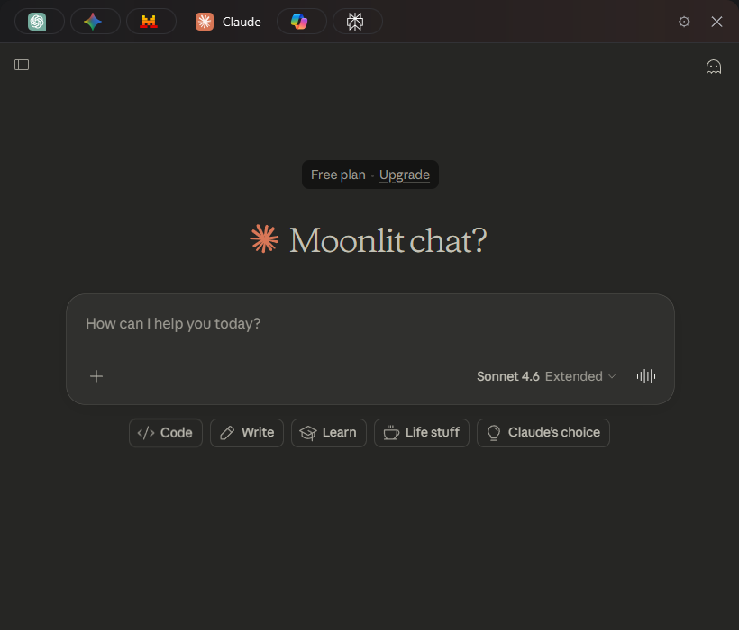
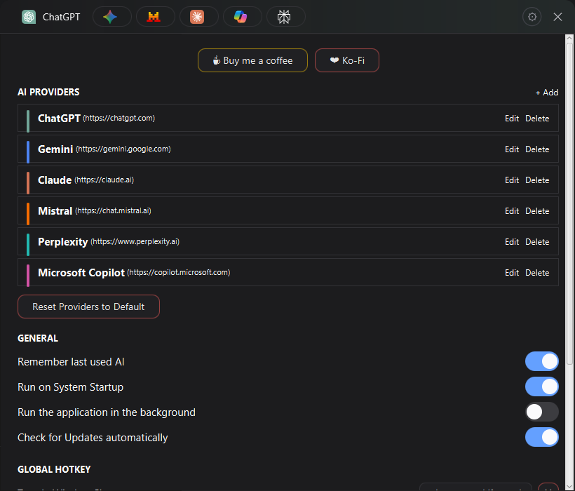
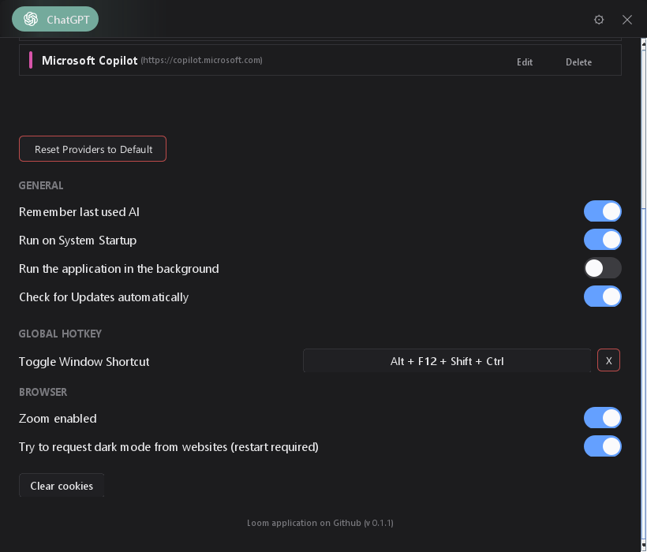

# Spark

<p align="center">

</p>

A modern, lightweight desktop application that provides unified access to multiple AI chat services through a sleek, always-on-top interface.

## Support

If this project helps you, consider supporting it:
- [Buy Me a Coffee](https://buymeacoffee.com/oldvalencia)
- [Ko-Fi](https://ko-fi.com/oldvalencia)

## Features

### 🎯 Multi-AI Support
Access your favorite AI services in one place. Pre-configured with:
- **ChatGPT**, **Google Gemini**, **Claude**, **Mistral**, **Perplexity**, **Microsoft Copilot**

### ✨ Key Features
- **Custom Providers Support** — Add any web-based AI service directly via Settings.
- **Global Hotkey** — Toggle the application visibility instantly (configurable).
- **Auto-Start** — Option to launch Spark automatically on system startup.
- **Always On Top** — Keep your AI assistant visible while working in other apps.
- **Page Persistence** — Remembers the last page of each site, including sites sharing a host.
- **Live Site Switching** — Visited sites stay loaded during the current app session, preserving drafts, scroll position, and ongoing requests when switching or hiding the window.
- **Clear Site Data** — On Windows, clears cookies (including HttpOnly cookies) and website storage across the Spark browser profile after confirmation. Open sites reload and you may need to sign in again.

### 🎨 Modern Interface
- **Animated Dock** — macOS-style icon dock with smooth transitions.
- **Drag & Drop Reordering** — Organize AI services to your preference.
- **Clean UI** — Minimalist design with a focus on content.

### ⚡ Performance
- Sites load on demand. Hiding preserves live state and does not suspend active requests.
- Memory includes the JVM and WebView2 child processes and depends on the sites you open. Visited sites stay loaded until removed or until Spark exits. JVM heap limits do not represent total application RAM.

## Screenshots

### Application Interface


### Settings & Provider Management


### Settings & Hotkeys


### Adding a Provider


## Installation

### Windows
1. Download `Spark-Windows-Installer.exe` from [Releases](https://github.com/OldValencia/ai-panel/releases).
2. Run the installer.

### macOS & Linux
*(Planned for future releases, but not currently supported)*

## Configuration

Access the **Settings Panel** via the gear icon (⚙) in the top-right corner.

### Managing AI Services
1. Go to **Settings** -> **Providers**.
2. Click **Add Provider**.
3. Enter the Name, URL, and choose an icon/color.
4. You can also disable or delete default providers.

### Global Hotkey
- Use this to quickly show/hide the application.

### Data Location
Application data is stored in your user directory:
- **Windows**: `C:\Users\<User>\Documents\OldValencia\Spark\`
- **macOS/Linux**: `~/Library/Application Support/OldValencia/Spark/` *(Planned)*

Contains:
- `app-config.json` — General preferences.
- `providers.json` — Your site configurations.
- `*.json.bak` — The previous readable configuration, used for recovery.
- `logs/` — Application logs.

## Building from Source

### Prerequisites
- JDK 21
- Gradle 8.x (wrapper included)

### Build Steps
```bash
# Clone repository
git clone https://github.com/OldValencia/spark.git
cd spark

# Run locally
./gradlew run

# Build installers
./gradlew clean build createInstaller

# Unit and regression tests
./gradlew test

# Windows integration tests with real WebView2 and a disposable profile
./gradlew nativeTest
```

Native tests require the WebView2 Runtime. They use a fresh `build/native-tests/` directory for browser data and preferences, local HTTP fixtures, and off-screen/hidden windows. They never use or clear installed Spark sessions. See [P1 validation notes](docs/p1-validation.md) for coverage and measurement limitations.

Remembered page addresses survive a restart when enabled. Unsent drafts and running requests are live browser state and survive only while Spark is running. Clearing site data is an explicit destructive action; it is never part of hiding or ordinary startup.
