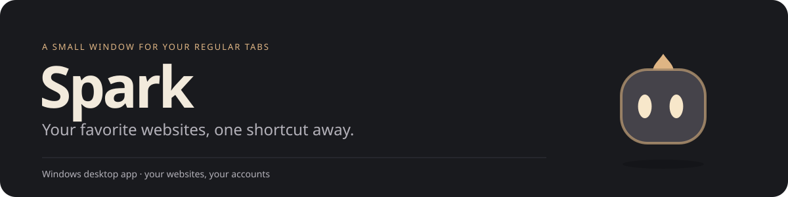
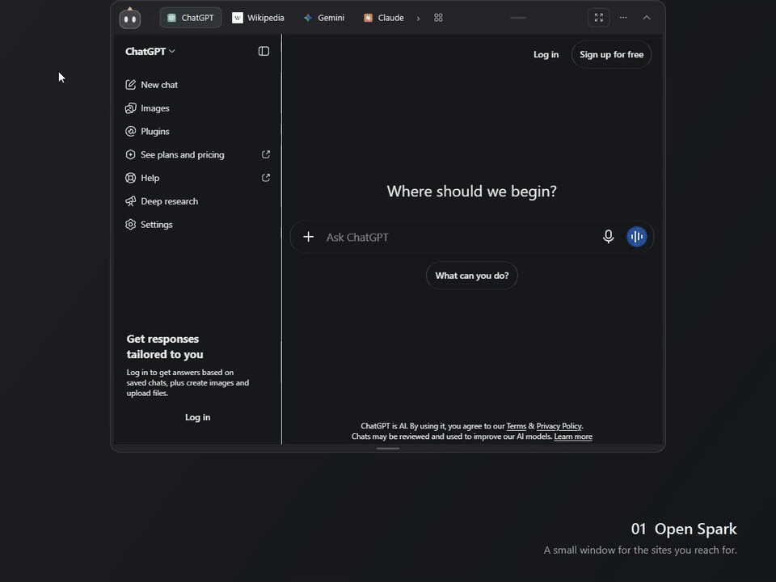
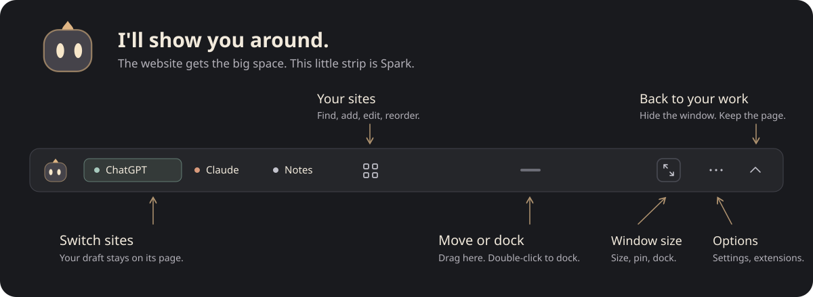
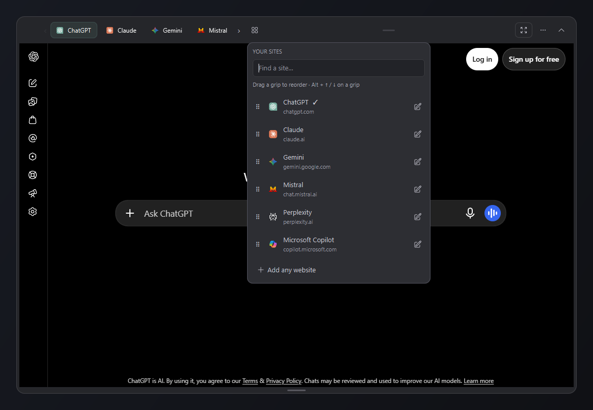
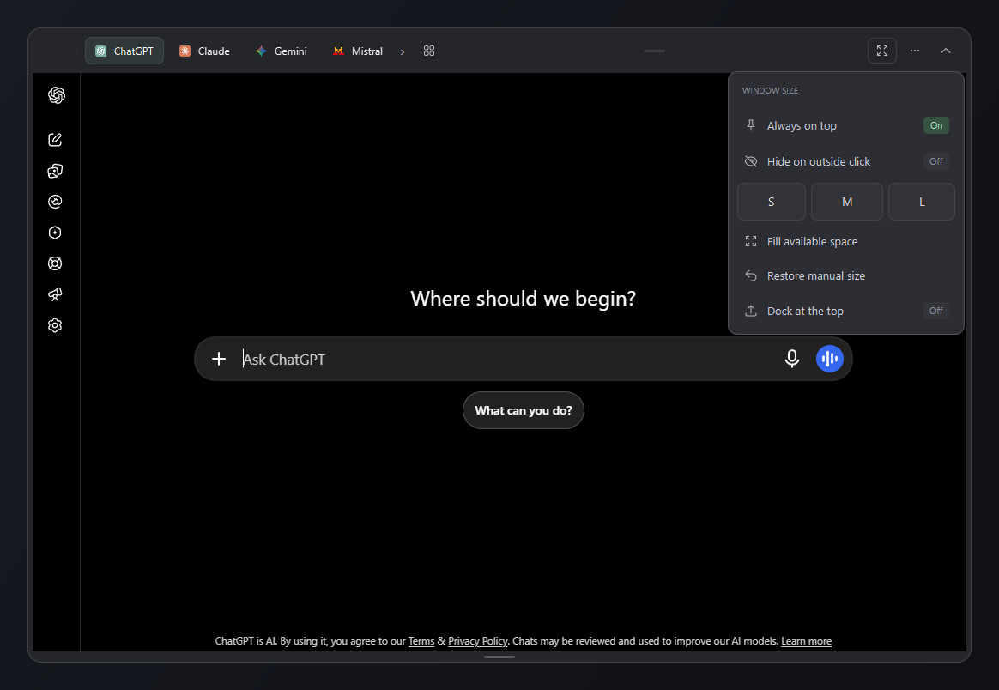
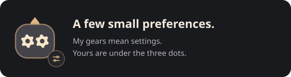
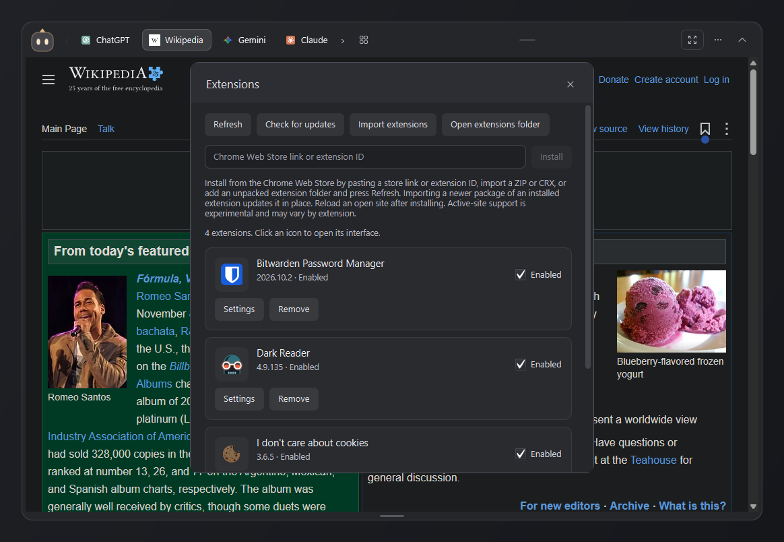
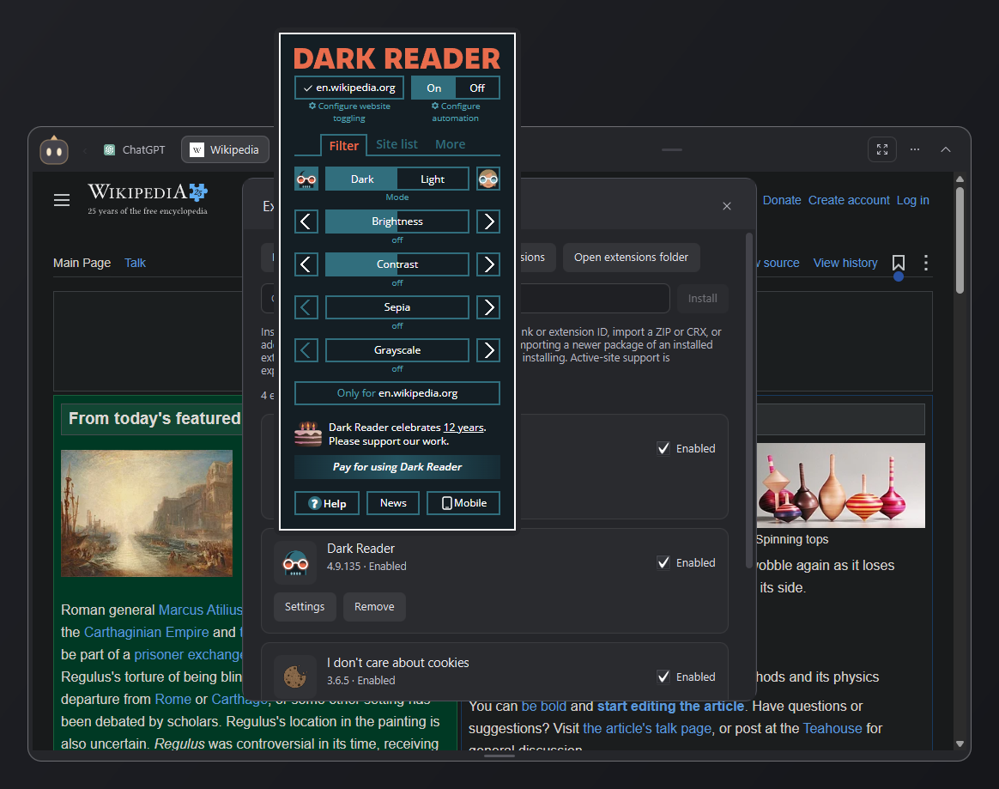

<p align="center">
  
</p>

<p align="center">
  <strong><a href="https://github.com/OldValencia/spark/releases">Download for Windows</a></strong>
  &nbsp;·&nbsp; <a href="#watch-spark">Watch Spark</a>
  &nbsp;·&nbsp; <a href="#a-quick-tour">Take a look around</a>
  &nbsp;·&nbsp; <a href="#start-here">Get started</a>
  &nbsp;·&nbsp; <a href="docs/troubleshooting.md">Troubleshooting</a>
  &nbsp;·&nbsp; <a href="#build-it">Build it</a>
</p>

Spark started with a shortcut on a spare mouse button: ask something, hide the window, come back to the same page. That's still the idea.

Keep **ChatGPT, Claude, Gemini, Mistral, Perplexity, Copilot**, or your own regular sites in a small desktop window. A question comes up, you open Spark, use the website, and put it away again. Your draft and scroll position stay with the page while Spark is running. On Windows you can bring a few Chrome extensions along, too.

## Watch Spark

About forty-five seconds: open it, switch sites, find a site, try a smaller window, open an extension, and have a look at the settings. No sound.

<p align="center">
  <a href="docs/media/spark-tour.mp4"></a>
  <br><sub>Recorded in Spark 0.3.3 with a separate, signed-out profile. <a href="docs/media/spark-tour.mp4">MP4</a> · <a href="docs/media/spark-tour-poster.png">Still image</a></sub>
</p>

## A quick tour

The little spark in the corner has volunteered to show you around.

<p align="center">
  <a href="docs/readme/tour.svg"></a>
</p>

<table>
  <tr>
    <td width="50%" valign="top">
      
      <p><strong>Open the grid → Add any website.</strong> Give it a name and a full <code>https://</code> address. AI services, notes, documentation, a translator — pick what you actually use.</p>
      <p>Search the list, edit with the pencil, or drag a grip to reorder. Tabs can be dragged too. Keyboard alternative: <strong>Alt + ↑ / ↓</strong> on a list grip.</p>
      <a href="docs/screenshots/sites.png"></a>
    </td>
    <td width="50%" valign="top">
      
      <p><strong>Drag the handle to move the window.</strong> Double-click it to dock at the top. Resize by the edges, or use S / M / L in the size menu. Each preset's arrow lets you save the current size, rename the preset, or reset it to its default. Hover over a preset to see its full name and dimensions.</p>
      <p>Pin Spark above other apps when you want it handy. Hide on outside click is a separate choice. Your size and placement are remembered.</p>
      <a href="docs/screenshots/window-size.png"></a>
    </td>
  </tr>
</table>

<p align="center">
  
</p>

**Three dots → Settings** is where the shortcut, startup behavior and top-edge pill live. Page zoom is right in the three-dot menu, and each site remembers its own zoom.

<p align="center">
  
</p>

**Three dots → Extensions** brings Chrome extensions into Spark on Windows. Paste a Chrome Web Store link or extension ID and press **Install**, or import a ZIP/CRX package. Click an extension's icon to open its popover; click it again to close it. Extensions see the site you have open, so Dark Reader or uBlock Origin act on that page. **Check for updates** updates store extensions in place; importing a newer package updates the others. Their settings and data are kept.

<table>
  <tr>
    <td width="50%" valign="top"><a href="docs/screenshots/extensions.png"></a></td>
    <td width="50%" valign="top"><a href="docs/screenshots/extension-popup.png"></a></td>
  </tr>
</table>

Links and sign-in windows follow the website's normal browser behavior. Use **Three dots → Back** to go back, **Close page** to close an extra page, or **Open start page** to close extra pages and open the site's configured start address. **Close page** appears only while an extra page is open. Middle-click a link to send it to your default browser. Login windows share Spark's browser profile. Passkeys use the browser and Windows dialogs, with compatibility depending on the website and installed WebView2 runtime.

The mascot follows your pointer, peeks at the site list, and briefly gets gear eyes when you open settings. Click it for a hello. **General → Reduce motion** keeps it still; **Show mascot** lets it sit this one out.

<sub>The tour and mascot cards are illustrations. The screenshots show the Windows app in 0.3.3; click one for a closer look. <a href="docs/previews/0.3.1-mascot-topbar-860.png">Current header</a> · <a href="docs/previews/0.3.1-mascot-settings.png">Gear eyes</a></sub>

## Start here

1. Grab the Windows `.exe` from [Releases](https://github.com/OldValencia/spark/releases) and install it. Java is included.
2. Choose a site and sign in as you normally would.
3. Open **Three dots → Settings → Global Hotkey** and record your **Toggle window shortcut**.

A spare mouse button makes a good home for that shortcut.

Something not working as expected? Check [troubleshooting and tips](docs/troubleshooting.md).

**Windows x64** is the supported and tested target. Spark needs the [Evergreen WebView2 Runtime](https://developer.microsoft.com/microsoft-edge/webview2/); install it if it's missing. The websites use your own accounts and subscriptions.

<details>
<summary><strong>Shortcuts and the top-edge pill</strong></summary>

| Do this | Use this |
| --- | --- |
| Show or hide Spark | Your global shortcut |
| Open Spark | The tray or top-edge pill |
| Switch sites | **Ctrl + 1…8** by position, **Ctrl + 9** for the last, **Ctrl + Tab** / **Ctrl + Shift + Tab** |
| Move the window | Drag the central handle |
| Dock at the top | Double-click the handle, or **Window size → Dock at the top** |
| Resize, pin, or fill the screen | **Window size** menu |
| Hide Spark | The chevron at the right of the header |
| Zoom the website | **Ctrl + mouse wheel**, **Ctrl + +**, **Ctrl + −** |
| Reset zoom | **Ctrl + 0** |

The pill stays visible by default. In **Settings → Pill**, enable **Auto-hide top-edge pill** to reveal it as you approach the top-center edge.

With auto-hide enabled, **Quick upward gesture** can open Spark directly on a fast upward movement. A slow approach previews the pill. Quick opening is off by default. **Open on top-edge hover** controls delayed opening when the pill is kept visible.

</details>

## When you come back

Visited pages stay loaded until you remove the site or quit Spark. Switching sites or hiding the window preserves the live page, including drafts, scrolling and ongoing requests. New visits appear once the document is ready; **Show page** is available while the rest loads.

After a restart, **Remember last site** restores saved page addresses from the configured site. Addresses containing `?` query parameters or `#` fragments are skipped by automatic history, so temporary sign-in parameters are not written to preferences. Sites that identify pages only through those parameters return to the previous saved address or the configured start page. Drafts and conversations across restarts depend on what the website itself saves.

Each loaded website uses memory. **Settings → Browser → Reduce background memory** lets Windows reclaim memory from hidden pages while keeping them alive. The total depends on the sites you've opened. If the site takes a few seconds to appear when you reopen Spark, turn this setting off; see [troubleshooting](docs/troubleshooting.md).

**Extensions are experimental in 0.3.3 and need Windows x64.** Extensions are installed unpacked into your Spark folder and run in Spark's browser profile; each enabled extension uses some memory of its own. Popovers tell an extension which site is open, but the full Chrome toolbar is not there: toolbar button events, automatic `activeTab` access and side panels are not implemented, and password-manager autofill is not guaranteed. See [extension usage and validation](docs/extensions.md).

<details>
<summary><strong>Where Spark keeps things, and what “Clear site data” does</strong></summary>

Settings on Windows live here:

```text
%USERPROFILE%\Documents\OldValencia\Spark\
├── app-config.json     Preferences and remembered pages
├── providers.json      Your site collection
├── *.json.bak          Previous readable configuration files
├── icons\              Site icons
├── extensions\         Imported extensions (one folder each)
└── logs\               Application logs
```

**Settings → Browser → Clear site data** clears cookies and website storage across Spark's browser profile after confirmation. It signs you out and reloads open sites, so finish or copy any unsent text first.

</details>

## Build it

Use **JDK 21**, with `JAVA_HOME` pointing to it. The Gradle wrapper is included.

```powershell
git clone https://github.com/OldValencia/spark.git
cd spark

.\gradlew.bat run               # Run Spark
.\gradlew.bat test              # Unit and regression tests
.\gradlew.bat installDist       # Build an application distribution
.\gradlew.bat nativeTest        # Windows UI and real WebView2 tests
.\gradlew.bat createInstaller   # Windows installer; requires WiX on PATH
.\gradlew.bat readmeCapture     # README video and screenshots; moves the real mouse
```

Distributions go to `build/install/Spark/`, installers to `build/installer/`. Native tests use disposable profiles under `build/native-tests/` and leave installed sessions alone. More detail: [browser validation](docs/p1-validation.md), [P3 interactions](docs/p3-validation.md), [memory and background work](docs/p4-validation.md), [native libraries](docs/native/README.md), [extensions](docs/extensions.md), [README media](docs/media/README.md).

macOS packaging and libraries for other targets are in the repository, but remain experimental. On macOS/Linux, use `./gradlew`.

## Say hello

Found a bug, or have a small thing that would make Spark nicer to use? [Open an issue](https://github.com/OldValencia/spark/issues). A screenshot and the steps that got you there help a lot.

You can also buy the developer a coffee through [Buy Me a Coffee](https://buymeacoffee.com/oldvalencia) or [Ko-fi](https://ko-fi.com/oldvalencia).

Spark's own code and artwork are available under the [MIT license](LICENSE). The browser bridge and bundled libraries retain their respective licenses; see [third-party notices](THIRD_PARTY_NOTICES.md).
