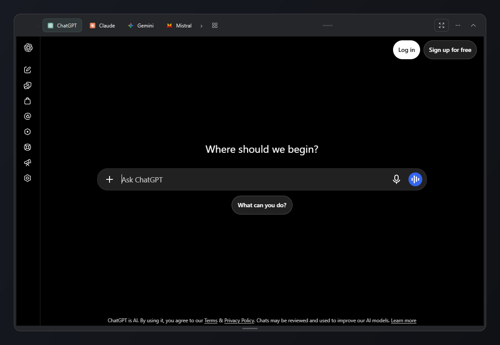
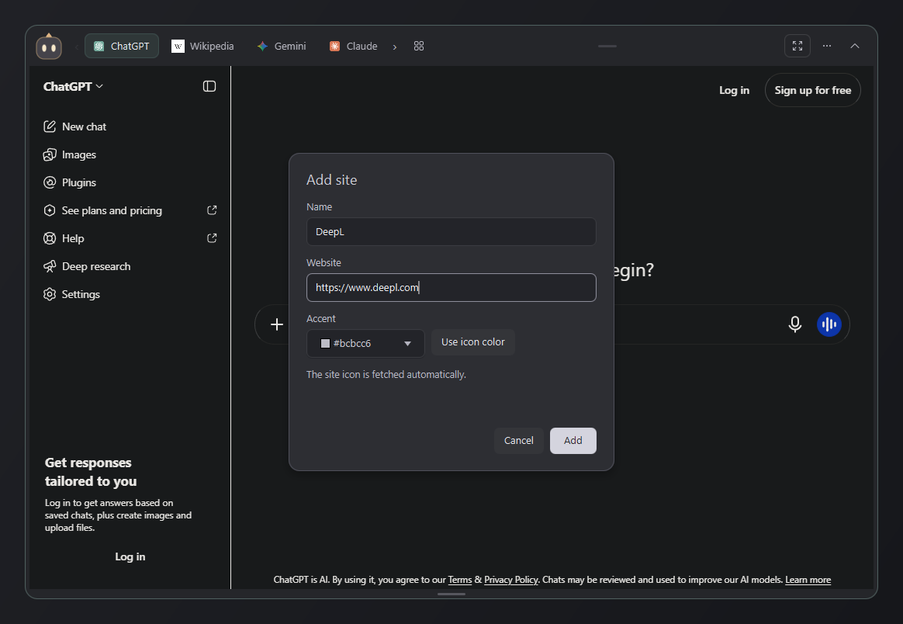
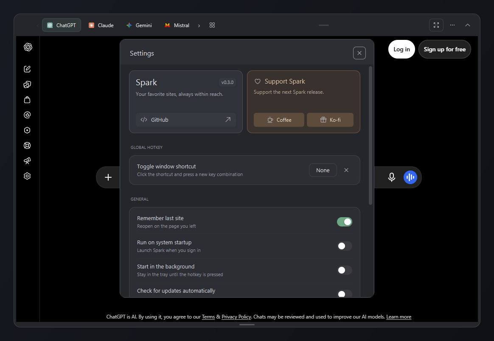

<p align="center">
  
</p>

<h1 align="center">Spark</h1>

<p align="center">
  <strong>Your favorite websites, one shortcut away.</strong>
</p>

<p align="center">
  <a href="https://github.com/OldValencia/spark/releases">Download for Windows</a>
  &nbsp;·&nbsp;
  <a href="#getting-started">Getting started</a>
  &nbsp;·&nbsp;
  <a href="#building-from-source">Build from source</a>
  &nbsp;·&nbsp;
  <a href="#support">Support</a>
</p>

A compact desktop app for **ChatGPT, Claude, Gemini, Mistral, Perplexity, Copilot**, and any other website you want close at hand.

_Switch between sites, and hide it when you're done. Visited pages stay alive during the app session, keeping your drafts, scroll position, and ongoing requests when you switch or hide the window._

<p align="center">
  <a href="docs/screenshots/spark-main.png">
    
  </a>
  <br>
  <sub>Spark 0.3.0 on Windows, with the live ChatGPT website. Captured using a separate profile.</sub>
</p>

## Made for quick access

| Feature | What it does |
| --- | --- |
| **Your own site collection** | Use the bundled AI services or add any website with a name, URL, and accent color. |
| **Live site switching** | Revisit loaded sites without starting a new page each time. |
| **A window that fits your work** | Pin it above other apps, resize it, choose S / M / L, or dock it at the top of the screen. |
| **Quick show and hide** | Set a global shortcut, use the tray, or bring Spark back through its top-edge pill. |
| **A familiar place to return to** | Remember each site's last page and keep your preferred site order. |
| **Small, useful controls** | Search sites, drag to reorder, adjust page zoom, reduce motion, and configure startup behavior. |

## A closer look

<table>
  <tr>
    <td width="50%" align="center">
      <a href="docs/screenshots/sites.png"></a>
      <br><strong>All your sites</strong><br>
      Search, reorder, and edit your collection.
    </td>
    <td width="50%" align="center">
      <a href="docs/screenshots/window-size.png"></a>
      <br><strong>Your window, your way</strong><br>
      Pin it, resize it, or dock it at the top.
    </td>
  </tr>
  <tr>
    <td width="50%" align="center">
      <a href="docs/screenshots/add-site.png"></a>
      <br><strong>Add any website</strong><br>
      Pick a name, enter its URL, and choose an accent.
    </td>
    <td width="50%" align="center">
      <a href="docs/screenshots/settings.png"></a>
      <br><strong>Keep it personal</strong><br>
      Keep motion and pill preferences together in Settings.
    </td>
  </tr>
</table>

Click a screenshot to view it at full size. All captures show the actual Windows application; the DeepL entry is an unsaved example.

## Getting started

**Windows x64** is the supported and tested target. The installer includes Java; you do not need to install a JDK to use it.

1. Download the Windows installer (`.exe`) from [Releases](https://github.com/OldValencia/spark/releases) and install Spark.
2. Choose a site from the top bar and sign in to that website if needed.
3. Open **Window options → Settings** and record a **Toggle window shortcut** for quick access.

Spark uses the [Microsoft Edge WebView2 Runtime](https://developer.microsoft.com/microsoft-edge/webview2/). Install the Evergreen Runtime if it is missing from your system.

### Add and organize sites

Open **All sites** using the grid button in the top bar. Choose **Add any website**, enter a name and a full `https://` URL, then select **Add**. Icons are fetched automatically; accents can use the icon color or a color you choose.

Use the pencil button to edit or remove a site. Drag its grip to change the order, or focus the grip and press **Alt + ↑ / ↓**. You can also reorder tabs directly in the top bar.

### Window and keyboard controls

| Action | Control |
| --- | --- |
| Show or hide Spark | Your configured global shortcut |
| Move the window | Drag the handle in the top bar |
| Dock at the top | Double-click the handle, or use **Window size → Dock at the top** |
| Resize, pin, or fill available space | **Window size** menu |
| Hide Spark | The chevron at the right of the top bar |
| Open settings | **Window options → Settings** |
| Reduce animations | **Settings → General → Reduce motion** |
| Zoom the page | **Ctrl + mouse wheel**, **Ctrl + +**, or **Ctrl + −** |
| Reset page zoom | **Ctrl + 0** |

The **Settings → Pill** section groups all top-edge behavior. The pill stays visible by default. Enable **Auto-hide top-edge pill** to reveal it only when approaching the top-center edge. With auto-hide enabled, you can also turn on **Quick upward gesture**: a fast upward movement opens Spark directly while the pill is hidden; a slow approach previews the pill. Quick opening is off by default and is switched off when you disable auto-hide.

**Open on top-edge hover**, in the same Pill section, controls delayed opening when the pill is kept visible. **Reduce motion** lives in **Settings → General**, alongside startup and remembered-page preferences.

## Sessions and local data

Visited sites stay loaded until they are removed or Spark exits. Unsent drafts and ongoing requests belong to that live session. With **Remember last site** enabled, saved page addresses can be restored after a restart.

**Reduce background memory** lets Windows reclaim memory from hidden pages while keeping them alive. Total RAM use depends on the websites and the number of loaded sites.

**Settings → Browser → Clear site data** clears cookies and website storage across Spark's browser profile after confirmation. It signs you out and reloads open sites; unsent text will be lost.

On Windows, Spark stores its settings under:

```text
%USERPROFILE%\Documents\OldValencia\Spark\
├── app-config.json     Preferences and remembered pages
├── providers.json      Your site collection
├── *.json.bak          Previous readable configuration files
├── icons\              Site icons
└── logs\               Application logs
```

Spark opens the services' own websites. Accounts, subscriptions, and service limits are handled by each website.

## Building from source

Use **JDK 21** with `JAVA_HOME` pointing to it. The Gradle wrapper is included.

```powershell
git clone https://github.com/OldValencia/spark.git
cd spark

# Run the application
.\gradlew.bat run

# Run unit and regression tests
.\gradlew.bat test

# Build an application distribution
.\gradlew.bat installDist

# Build the Windows installer; requires WiX on PATH
.\gradlew.bat createInstaller
```

Distributions are written to `build/install/Spark/`; installers go to `build/installer/`.

To run the Windows integration and UI tests with real WebView2:

```powershell
.\gradlew.bat nativeTest
```

Native tests use disposable application and browser profiles under `build/native-tests/`. They require a recent Evergreen WebView2 Runtime and leave installed Spark sessions untouched. See the [validation notes](docs/p1-validation.md) and [native library documentation](docs/native/README.md) for details.

The repository also includes macOS packaging and native libraries for other targets. These integrations are experimental. On macOS/Linux, use `./gradlew` in place of `.\gradlew.bat`.

## Support

If Spark is useful to you, you can support its development through [Buy Me a Coffee](https://buymeacoffee.com/oldvalencia) or [Ko-fi](https://ko-fi.com/oldvalencia).

Bug reports and suggestions are welcome in [Issues](https://github.com/OldValencia/spark/issues).

## License

[GNU AGPL v3](LICENSE).
